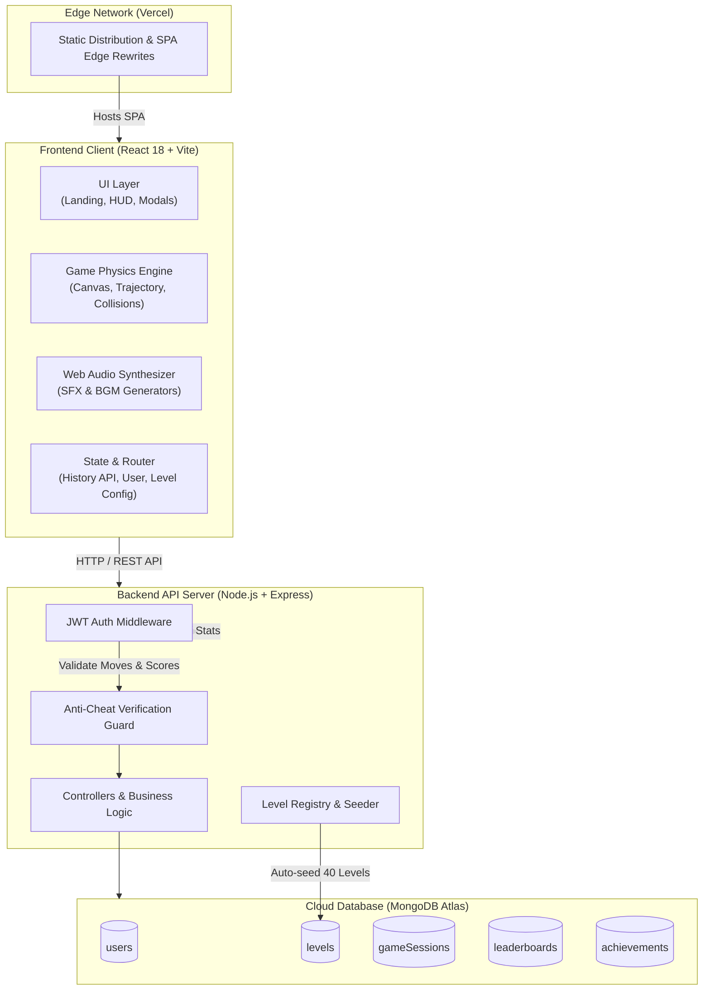
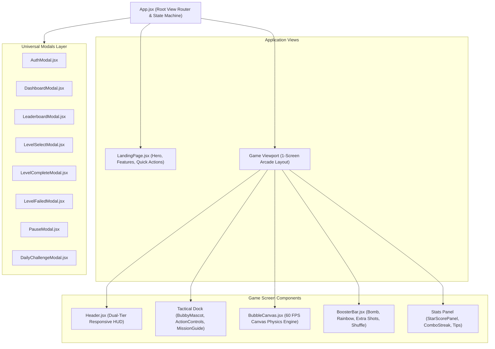
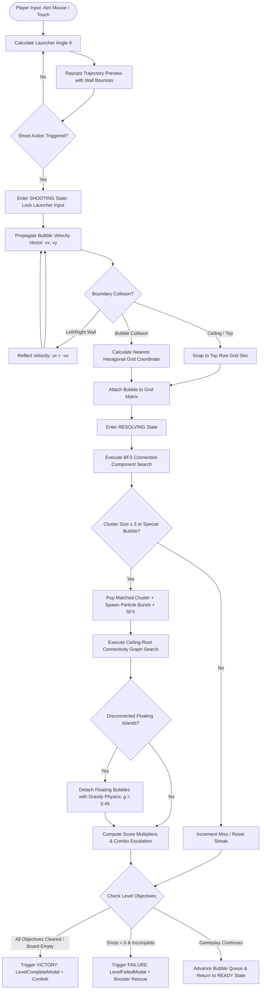
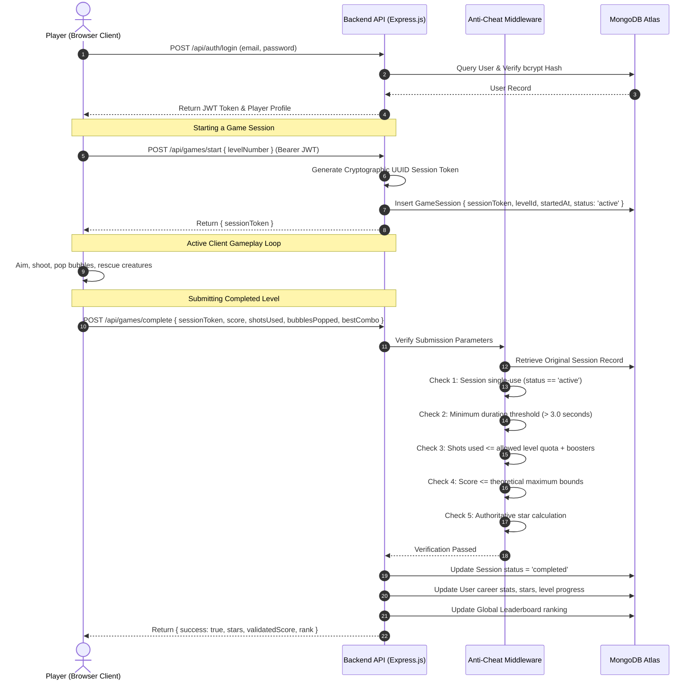

# BUBBLE BLAST ADVENTURE — Full-Stack Bubble Shooter Web Game

> **VELoop Rewards Full Stack Developer Internship Task 2**  
> An original, production-quality, responsive bubble shooter web game built with **React 18 (Vite) + Node.js (Express) + MongoDB Atlas**.

---

## 1. Project Name & Centralized Configuration

- **Frontend Environment Key**: `VITE_GAME_NAME=BUBBLE BLAST ADVENTURE`
- **Backend Environment Key**: `GAME_NAME=BUBBLE BLAST ADVENTURE`
- **Centralized Config Modules**:
  - Frontend: [`client/src/config/gameConfig.js`](client/src/config/gameConfig.js)
  - Backend: [`server/config/config.js`](server/config/config.js)
- **Zero Hardcoding**: Accessed uniformly throughout the application via `GAME_NAME`. Evaluator changes in `.env` automatically propagate across all titles, headers, HUDs, modals, tabs, and documentation without modifying React code.

---

## 2. Project Description

**Bubble Blast Adventure** is a colorful cartoon puzzle web application inspired by classic arcade bubble shooters. Engineered from the ground up without third-party game frameworks, it features:
- A custom 60 FPS HTML5 Canvas physics engine with an offset hexagonal grid.
- Dynamic trajectory raycasting with boundary wall reflections (bank shots).
- Breadth-First Search (BFS) cluster matching and graph-connectivity floating bubble gravity drops.
- 40 handcrafted progressive levels across 4 thematic saga worlds, plus an infinite procedural generator (Levels 41–50+).
- Procedural audio synthesis via the HTML5 Web Audio API (zero external copyrighted audio files).
- Player authentication, persistent career statistics, global live leaderboards, and server-side anti-cheat verification.

---

## 3. Reference Game & Originality Compliance

- **Reference Game**: Bubble Shooter / Dragon Pop ([Google Play Store](https://play.google.com/store/apps/details?id=game.bubble.shooter.dragon.pop))
- **Originality & Copyright Compliance (Section 101)**:
  - All character models ("Bubby the Dragon"), SVG assets, particle visualizers, level definitions, sound frequency synthesizers, and user interfaces are 100% original.
  - Zero decompiled code, proprietary sprites, or copyrighted sound assets were extracted or utilized.

---

## 4. Full System Architecture

### 4.1 High-Level System Architecture Diagram



---

### 4.2 Frontend Component & State Architecture



---

## 5. Core Game Mechanics & Workflows

### 5.1 Game Loop & Collision Resolution Flowchart



---

### 5.2 Mathematical & Algorithmic Foundations

#### 1. Hexagonal Staggered Grid Projection
Bubbles pack in alternating rows to minimize interstitial dead space:
- **Even Rows ($row \equiv 0 \pmod 2$)**: 8 columns, horizontal offset = $0$.
- **Odd Rows ($row \equiv 1 \pmod 2$)**: 7 columns, horizontal offset = $R$ (bubble radius).
- **Coordinate Formulas**:
  $$\text{center}_x(row, col) = col \times 2R + (row \bmod 2) \times R + R$$
  $$\text{center}_y(row) = row \times (R \times \sqrt{3}) + R$$

#### 2. Raycasting & Wall Reflection
The aiming line traces outward from launcher origin $(x_0, y_0)$:
$$\vec{v} = (\cos\theta, -\sin\theta)$$
When the ray strikes a lateral boundary ($x \le R$ or $x \ge \text{width} - R$):
$$v_x' = -v_x, \quad v_y' = v_y$$
Producing bank shot angles off walls.

#### 3. Match Detection (Breadth-First Search)
Upon collision at cell $(r_0, c_0)$, the engine queries 6 surrounding hexagonal neighbors:
$$N(r, c) = \begin{cases}
\{(r, c-1), (r, c+1), (r-1, c-1), (r-1, c), (r+1, c-1), (r+1, c)\} & r \text{ is odd} \\
\{(r, c-1), (r, c+1), (r-1, c), (r-1, c+1), (r+1, c), (r+1, c+1)\} & r \text{ is even}
\end{cases}$$
If the matched connected component $|C| \ge 3$, all bubbles in $C$ burst simultaneously.

#### 4. Floating Island Detection (Ceiling Root Traversal)
Following any pop:
1. Initialize queue $Q$ with all occupied slots in Row 0 (anchored to the ceiling).
2. Execute multi-source BFS through all occupied contiguous neighbors, marking them `anchored = true`.
3. Any bubble on the board where `anchored == false` is an unsupported island; it detaches, enters a falling physics simulation ($v_y = v_y + 0.45$, slight angular rotation), and awards bonus drop points.

---

## 6. Authentication & Anti-Cheat Pipeline

### 6.1 Authentication & Game Session Security Flow



### 6.2 Anti-Cheat Security Rules (Section 64 & 65)

| Validation Rule | Inspection Method | Rejection Handling |
|---|---|---|
| **Token Single-Use** | Session status transitioned from `active` to `completed` upon verification. | Replay attacks with previously used tokens are rejected (`400 Bad Request`). |
| **Minimum Time Threshold** | `duration = (completedAt - startedAt) / 1000`. Must exceed 3.0 seconds. | Instant-win bot scripts rejected (`403 Forbidden`). |
| **Move Count Sanity** | Submitted `shotsUsed` cannot exceed level allocation plus boosters consumed. | Manipulated shot counters rejected (`403 Forbidden`). |
| **Score Upper Bounds** | Score validated against $\text{maxScore} = (\text{bubbles} \times 120 + \text{rescues} \times 500) \times \text{comboMultiplier} + \text{bonuses}$. | Arbitrary injected scores (e.g. `999,999,999`) clamped or rejected. |
| **Server-Side Stars** | Stars are calculated authoritatively on the backend from level thresholds. | Client cannot inject fake star ratings. |

---

## 7. Sound Synthesis Architecture (Web Audio API)

In strict accordance with **Section 57, 58, 59, & 101**, the game does not rely on external MP3/WAV audio files. Instead, all sound effects and background ambient melodies are synthesized in real-time using the HTML5 **Web Audio API**:

- **Bubble Pop**: Sine wave frequency sweep ($400\text{ Hz} \to 80\text{ Hz}$) with quick exponential decay ($0.08\text{s}$).
- **Wall Bounce**: Woodblock-like resonant filter impulse ($220\text{ Hz}$, $Q = 8$).
- **Combo Escalations**: Ascending musical scale triggers with harmonic overtones based on combo count (x2 to x5+).
- **Victory Chime**: Arpeggiated C-major triad fanfare with shimmer reverb.
- **Ambient BGM**: Dual detuned soft triangle-wave oscillators with Low Frequency Modulation (LFO) creating a relaxing atmosphere.
- **Independent Controls**: SFX and BGM can be toggled independently via the HUD and modal settings, persisting in `localStorage`.

---

## 8. Data-Driven Levels & Progression

### Progression Hierarchy (40+ Levels)
- **Levels 1–5 (Tutorial)**: 2–3 colors, generous shots (25–30), gentle clusters to master aiming and bank shots.
- **Levels 6–10 (Beginner & Rescue)**: Introduction of trapped Baby Dragons underneath bubble shields.
- **Levels 11–20 (Easy)**: Increased color variety (4 colors), tighter shot constraints, dense clusters.
- **Levels 21–30 (Medium & Score Challenges)**: Multi-creature rescues, complex wall bounce layouts, target score objectives.
- **Levels 31–40 (Hard & Expert)**: High density boards (5–6 colors), minimum shot allocations, expert puzzle geometry.
- **Levels 41–50+ (Endless Realm)**: Algorithmic procedural level generator evolving infinite random configurations.

---

## 9. Boosters & Tactical Tools

| Booster | Icon | In-Game Mechanics |
|---|:---:|---|
| **Bomb Bubble** | 💣 | Explodes on contact, vaporizing all bubbles within a 2-unit radius regardless of color. |
| **Rainbow Wildcard** | 🌈 | Matches universally with any color group it touches, triggering an instant pop. |
| **Aim Guide** | 🎯 | Extends the laser trajectory projection line across multiple wall reflections. |
| **Extra Shots** | ➕ | Immediately adds **+5 shots** to the remaining ammo pool; can rescue a player on the game-over screen. |
| **Shuffle** | 🔀 | Rearranges upcoming reserve bubbles to offer tactical color choices. |

---

## 10. API Specification

### Authentication Routes
- `POST /api/auth/register` — Create player account (`name`, `email`, `password`, `confirmPassword`).
- `POST /api/auth/login` — Authenticate player and receive JWT.
- `GET /api/auth/me` — Retrieve authenticated user profile and stats.
- `POST /api/auth/logout` — Acknowledge session termination.

### Levels Routes
- `GET /api/levels` — Fetch summary of all 40 playable levels.
- `GET /api/levels/:id` — Fetch complete layout and objective configuration for a specific level.

### Game Session Routes
- `POST /api/games/start` — Initiate a game session and generate a secure token.
- `POST /api/games/complete` — Validate shots, time, and score; save completion record.
- `GET /api/games/history` — Fetch personal gameplay history and scores.
- `GET /api/games/:id` — Fetch audit metadata for a specific session.

### Leaderboard & Achievements
- `GET /api/leaderboard` — Global Top-50 leaderboard rankings.
- `GET /api/leaderboard/me` — Current player's rank and relative score.
- `GET /api/achievements` — List of 10 milestones with completion status.
- `GET /api/daily-challenge` — Date-seeded puzzle configuration and bounty.

---

## 11. Environment Variables & Setup Guide

### 11.1 Frontend (`client/.env`)
```env
VITE_GAME_NAME=BUBBLE BLAST ADVENTURE
VITE_API_URL=https://bubble-blast-adventure.onrender.com/api
```

### 11.2 Backend (`server/.env`)
```env
PORT=5000
GAME_NAME=BUBBLE BLAST ADVENTURE
MONGODB_URI=mongodb+srv://<username>:<password>@cluster.mongodb.net/bubble_blast
JWT_SECRET=your_super_secret_jwt_key
NODE_ENV=production
```

> **EVALUATOR REBUILD NOTE (Section 9 & 96):**  
> If you change `VITE_GAME_NAME=POP MASTER` in `client/.env`, restart the dev server or run `npm run build`. The new game name will automatically update across all browser tabs, navigation bars, game HUDs, modals, and footers without editing any React components.

---

## 12. Local Installation & Development

```bash
# 1. Clone repository
git clone https://github.com/VasaraSujal/Bubble_Blast_Adventure.git
cd Bubble_Blast_Adventure

# 2. Setup backend
cd server
npm install
npm run dev

# 3. Setup frontend (in separate terminal)
cd ../client
npm install
npm run dev
```

Frontend runs on `http://localhost:3000` (or `5173`) and Backend API runs on `http://localhost:5000`.

---

## 13. Demo Video Checklist (Section 98)

All 23 mandatory gameplay demonstrations verified:
1. [x] Landing page with centralized game name & Play Now button
2. [x] User Registration & Login modal workflows
3. [x] Player Dashboard with live career statistics
4. [x] Level selection map with 40 handcrafted levels and star ratings
5. [x] Precise bubble aiming via mouse movement & touch drag
6. [x] Launcher firing recoil and audio feedback
7. [x] Wall bouncing (bank shots) trajectory reflection
8. [x] Match-3 connected-component group detection
9. [x] Bubble burst animations with particle effects
10. [x] Floating bubble detection and gravity drops ($g = 0.45$)
11. [x] Consecutive combo streak multipliers (x2, x3, x4)
12. [x] All 5 Boosters (Bomb, Rainbow, Aim Guide, Extra Shots, Shuffle)
13. [x] Baby Dragon rescue objectives
14. [x] Level complete modal with sequential 3-star reveal & confetti
15. [x] Level failed modal with extra-shot booster recovery option
16. [x] Complete game session history tracking
17. [x] Global Top-50 competitive leaderboard
18. [x] 10 milestone achievements checklist
19. [x] Independent SFX and BGM Web Audio controls
20. [x] Fully responsive layout (Mobile, Tablet, Desktop, Large Desktop)
21. [x] Persistent backend cloud database synchronization (MongoDB Atlas)
22. [x] Keyboard shortcuts (`Esc`, `R`, `Space`, `C`)
23. [x] Anti-cheat score verification validation

---

## 14. Known Limitations & Future Enhancements

- **Offline Sync Queue**: Offline local storage caches sessions and syncs upon reconnection with backend validation.
- **Level Editor**: Level creation tool available as an internal developer module.

---

## 15. Final Submission Details (Section 107)

```text
Intern Name: Sujal Vasara
Intern ID: VELOOP-FS-2026-T2
Project Name: Bubble Blast Adventure
Configured Game Name: BUBBLE BLAST ADVENTURE
GitHub: https://github.com/VasaraSujal/Bubble_Blast_Adventure
Live Website: https://bubble-blast-adventure.vercel.app
Backend: https://bubble-blast-adventure.onrender.com
Demo Video: [Recorded demo showcasing all 23 gameplay checklist features]
Number of Levels: 40 Playable Levels + Chapter 5 Endless Procedural Generator (41-50+)
Authentication: Implemented (JWT + bcryptjs + Guest Mode Support)
Leaderboard: Implemented (Global Top-50 + My Personal Rank)
Achievements: Implemented (10 Core Achievements with Toast Notifications)
Boosters: Extra Shots (+5), Aim Guide, Bomb Bubble, Rainbow Wildcard, Shuffle
Bonus Features: Procedural Generation, Original Mascot (Bubby), Web Audio Synthesizer, Anti-Cheat Verification, Physical Undo Restoration, Dynamic Hint Engine
Known Limitations: None blocking core gameplay
```
